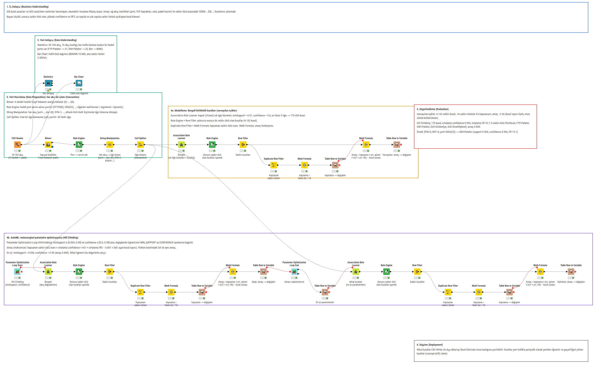

# Saldırı Vektörleri Arasında Birliktelik Kuralları (CICIDS2017)

Ağ akışı özellikleri (hedef port, TCP bayrakları, akış süresi, paket hacmi) ile saldırı türü arasındaki **"EĞER ... İSE ..."** kurallarını çıkaran bir birliktelik analizi. Örnek: `{FIN=0, RST=0, port=SSH(22)} → SSH-Patator` (confidence 0.97, lift 15). Problem önce **KNIME** ile, sonra **Python** ile, her ikisinde de **CRISP-DM** adımlarıyla çözüldü.



## Sonuçlar

### KNIME (Borgelt Association Rule Learner)

| | Varsayılan eşikler | Hill Climbing |
|---|---|---|
| minSupport / confidence | 0.01 / 0.80 | 0.034 / 0.90 |
| Saldırı kuralı sayısı | 4.132 | **173** |
| Kapsanan saldırı türü | 9 / 14 | 5 / 14 |
| Ortalama confidence / lift | - | 0.965 / 15.1 |
| Amaç fonksiyonu | -2.36 | **0.845** |

### Python (mlxtend)

| | Apriori | FP-Growth |
|---|---|---|
| Süre (min_support 0.01) | 68.0 sn | **2.2 sn** |
| Sık öğe kümesi | 84.136 | 84.136 |

| | Elle eşik (0.01 / 0.8) | GA (NSGA-II) |
|---|---|---|
| Kural sayısı (budama sonrası) | 337 | **75** |
| Kapsanan saldırı türü | - | 8 / 14 |
| Kurallara uyan akışlarda doğruluk | - | 0.848 |

Bot, FTP-Patator ve SSH-Patator kurallarının doğruluğu 1.00, PortScan 0.996.

## AutoML

| | KNIME | Python |
|---|---|---|
| Metasezgisel parametre optimizasyonu | Parameter Optimization Loop, **Hill Climbing** (minSupport, confidence) | Optuna **NSGA-II** genetik algoritma (n_bins, min_support, min_confidence, min_lift, max_len), 40 deneme |
| Amaç fonksiyonu | kapsama × ort. confidence × ln(1 + ort. lift) − kural sayısı cezası | aynı |
| Algoritma karşılaştırması | Borgelt (kapalı öğe kümeleri) | Apriori ve FP-Growth |

İki taraf aynı amaç fonksiyonunu kullanıyor. GA geniş uzayda daha iyi bir nokta buldu (8 tür kapsandı), Hill Climbing ise yerel bir optimumda durdu (5 tür).

## Klasör yapısı

```
knime/       KNIME_Birliktelik_SaldiriVektorleri.knwf, iş akışı görseli (png/svg)
notebooks/   01_attack_vector_association_rules.ipynb (çalıştırılmış, çıktılarıyla)
docs/        KNIME_Raporu.md, Python_Raporu.md, figures/
data/        39.183 akışlık örneklem ve kaynak bilgisi
results/     attack_rules.csv (Python kuralları), knime_results_raw.json (KNIME sonuçları)
```

## Çalıştırma

**KNIME:** KNIME Analytics Platform 5.x → File → Import KNIME Workflow → `knime/KNIME_Birliktelik_SaldiriVektorleri.knwf`. Veri iş akışının içinde.

**Python:**
```bash
pip install -r requirements.txt
jupyter notebook notebooks/01_attack_vector_association_rules.ipynb
```

## Raporlar

- [KNIME raporu](docs/KNIME_Raporu.md)
- [Python raporu](docs/Python_Raporu.md)

**Veri seti notu:** Görev dokümanında örnek olarak Shadowserver CTI verisi önerilmişti. Bu veri yalnızca kayıtlı kurumlara açık olduğu için aynı problem tipi kamuya açık [CICIDS2017](https://www.unb.ca/cic/datasets/ids-2017.html) üzerinde çözüldü.
