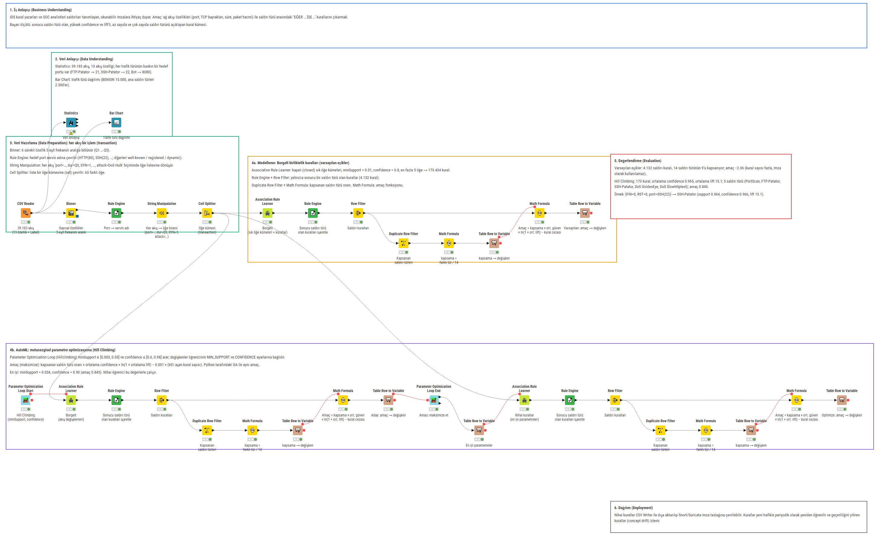

# KNIME Raporu: Saldırı Vektörleri Arasında Birliktelik Kuralları

İş akışı: `knime/KNIME_Birliktelik_SaldiriVektorleri.knwf` (KNIME Analytics Platform 5.x)



İş akışı CRISP-DM aşamalarına göre renkli kutulara ayrılmıştır. Her kutunun içinde o aşamanın açıklaması yazılıdır.

## 1. İş Anlayışı

IDS kural yazarları ve SOC analistleri saldırıları tanımlayan, okunabilir imzalara ihtiyaç duyar. Amaç, akış özellikleri (port, TCP bayrakları, süre, paket hacmi) ile saldırı türü arasındaki "EĞER ... İSE ..." kurallarını çıkarmak.

Başarı ölçütü:
- Kuralın sonucu bir saldırı türü olmalı.
- Confidence ve lift yüksek olmalı.
- Az sayıda kural, çok sayıda saldırı türünü açıklamalı.

## 2. Veri Anlayışı

| Düğüm | Görev |
|---|---|
| CSV Reader | 39.183 akış, 13 akış özelliği + gün + Label |
| Statistics | Dağılımlar; her trafik türünün baskın bir hedef portu var |
| Bar Chart | BENIGN 15.000, ana saldırı türleri 2.500'er |

## 3. Veri Hazırlama: her akış bir işlem (transaction)

| Düğüm | Görev |
|---|---|
| Binner | 6 sürekli özellik (süre, ileri/geri paket sayısı, bayt/sn, ortalama paket boyu, ilk pencere boyutu) 5 eşit frekanslı aralığa bölünür: Q1 ... Q5 |
| Rule Engine | Hedef port servis adına çevrilir: `HTTP(80)`, `SSH(22)`, `FTP(21)`, `DNS(53)`, `HTTP-ALT(8080)`...; diğerleri well-known / registered / dynamic |
| String Manipulation | Her akış öğe listesine dönüşür: `port=HTTP-ALT(8080),dur=Q3,...,PSH=1,ACK=0,attack=Bot` |
| Cell Splitter | Liste bir küme (set) hücresine çevrilir. Toplam 63 farklı öğe |

## 4a. Modelleme: Borgelt birliktelik kuralları

**Association Rule Learner** (Borgelt) ayarları:
- Kapalı (closed) sık öğe kümeleri
- minSupport = 0.01, confidence = 0.8
- En fazla 5 öğe

Bu ayarlarla **173.434 kural** üretildi.

Değerlendirme zinciri (her model için aynı):

```
Rule Engine (sonucu "attack=" ile başlayan ve BENIGN olmayan kuralları işaretle) → Row Filter
  → Duplicate Row Filter (farklı sonuçlar) → Math Formula: kapsama = ROWCOUNT / 14 → Table Row to Variable
  → Math Formula: amaç → Table Row to Variable
```

**Amaç fonksiyonu** (Python tarafındaki genetik algoritma ile aynı):

```
kapsama × ortalama confidence × ln(1 + ortalama lift) − 0.001 × max(0, kural sayısı − 60)
```

Math Formula'da `COL_MEAN`, `ROWCOUNT` ve `if()` fonksiyonlarıyla, kapsama ise akış değişkeni olarak (`$${Dcoverage}$$`) hesaplanır.

## 4b. AutoML: metasezgisel parametre optimizasyonu (Hill Climbing)

```
Parameter Optimization Loop Start (Hillclimbing: minSupport 0.003-0.05, confidence 0.6-0.98)
  → Association Rule Learner (MIN_SUPPORT, CONFIDENCE akış değişkenlerine bağlı) → değerlendirme zinciri
→ Parameter Optimization Loop End (amacı maksimize et)
→ Table Row to Variable → Nihai Association Rule Learner → değerlendirme zinciri
```

Hill Climbing'in denediği noktalar:

| minSupport | confidence | Amaç |
|---|---|---|
| 0.031 | 0.86 | -0.175 |
| 0.031 | 0.90 | -0.128 |
| 0.034 | 0.82 | 0.670 |
| 0.034 | 0.86 | 0.812 |
| **0.034** | **0.90** | **0.845** |
| 0.034 | 0.94 | 0.734 |
| 0.037 | 0.82 | 0.523 |
| 0.037 | 0.86 | 0.653 |
| 0.037 | 0.90 | 0.681 |
| 0.040 | 0.86 | 0.685 |

## 5. Değerlendirme

| | Varsayılan eşikler | Hill Climbing |
|---|---|---|
| minSupport / confidence | 0.01 / 0.80 | 0.034 / 0.90 |
| Saldırı kuralı sayısı | 4.132 | **173** |
| Kapsanan saldırı türü | 9 / 14 | 5 / 14 |
| Ortalama confidence | - | 0.965 |
| Ortalama lift | - | 15.1 |
| Amaç | -2.36 | **0.845** |

Optimize edilmiş kümeden her saldırı türü için en güçlü kural:

| Öncül | Sonuç | Support | Confidence | Lift |
|---|---|---|---|---|
| port=registered, dur=Q1, PSH=1, ... | PortScan | 0.047 | 0.999 | 15.7 |
| pkt_len=Q3, FIN=0, RST=0, ... | FTP-Patator | 0.063 | 0.994 | 15.6 |
| pkt_len=Q5, port=HTTP(80), dur=Q4, ... | DoS GoldenEye | 0.040 | 0.975 | 15.3 |
| FIN=0, RST=0, port=SSH(22) | SSH-Patator | 0.064 | 0.966 | 15.1 |
| port=HTTP(80), init_win=Q5, dur=Q5, ... | DoS Slowhttptest | 0.037 | 0.937 | 14.7 |

- Varsayılan eşikler binlerce birbirine benzeyen kural üretiyor; bunlar imza olarak kullanılamaz.
- Hill Climbing kural sayısını 24 kat azalttı. Kalan kuralların güveni 0.97, lift'i 15: rastlantıdan 15 kat güçlü ilişki.
- Bedeli kapsama: daha yüksek support eşiği, az örnekli saldırı türlerini (Bot, DDoS, DoS Hulk, slowloris) dışarıda bıraktı.
- Python tarafındaki GA daha düşük support (0.003) ile 75 kural ve 8 saldırı türü buldu. GA geniş uzayda daha iyi bir nokta buldu; Hill Climbing yerel bir optimuma takıldı. Bu, iki metasezgiselin karşılaştırması açısından beklenen bir fark.

## 6. Dağıtım

Nihai kurallar CSV Writer ile dışa aktarılıp Snort/Suricata imza taslaklarına çevrilebilir. Kurallar yeni trafikle periyodik olarak yeniden öğrenilmeli ve geçerliliğini yitiren kurallar (concept drift) izlenmelidir.
