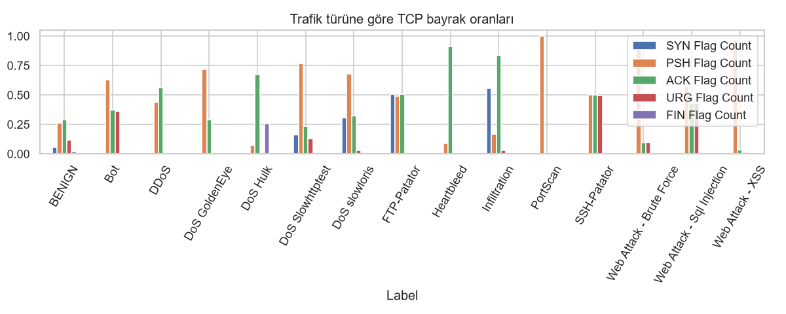
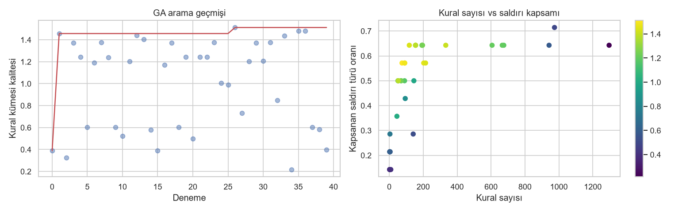
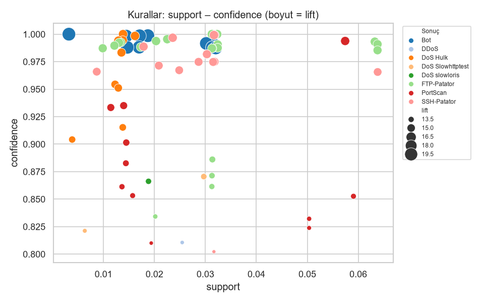

# Python Raporu: Saldırı Vektörleri Arasında Birliktelik Kuralları (CICIDS2017)

Notebook: [`notebooks/01_attack_vector_association_rules.ipynb`](../notebooks/01_attack_vector_association_rules.ipynb) (çalıştırılmış, tüm çıktılarıyla)

Kütüphaneler: pandas, mlxtend (Apriori, FP-Growth), Optuna, matplotlib, seaborn.

## 1. İş Anlayışı

SOC analistleri ve IDS kural yazarları saldırıları tanımlayan, yorumlanabilir imzalara ihtiyaç duyar. Birliktelik kuralları kara kutu bir model yerine doğrudan okunabilir "EĞER ... İSE ..." ifadeleri üretir. Örnek: `{SYN=1, port=FTP(21)} → FTP-Patator`.

- Kuralın sonucu bir saldırı türü olmalı.
- Ölçütler: yüksek **confidence** (kesinlik), **lift > 1** (rastlantıdan güçlü ilişki), yeterli **support**, ve mümkün olduğunca çok saldırı türünü açıklayan az sayıda kural.

**Veri seti notu:** Görev dokümanında örnek olarak Shadowserver CTI verisi önerilmişti. Bu veri yalnızca kayıtlı kurumlara sunulduğu ve kamuya açık kopyası olmadığı için, aynı problem tipi (saldırı vektörü özellikleri → saldırı türü) kamuya açık **CICIDS2017** üzerinde çözüldü.

## 2. Veri Anlayışı

- 8 günlük trafikten sınıf başına sınırlı örnek: **39.183 akış**, 13 seçilmiş akış özelliği + gün + etiket. BENIGN 15.000, ana saldırı türleri 2.500'er.
- Her trafik türünün baskın hedef portu çok belirgin: FTP-Patator → 21, SSH-Patator → 22, Bot → 8080, DoS/DDoS/Web saldırıları → 80, BENIGN → 53 (DNS).
- TCP bayrakları (SYN, FIN, PSH, ACK, URG, RST) türler arasında belirgin farklar gösteriyor.

## 3. Veri Hazırlama

- **Port:** bilinen servis portları isimlendirildi (`port=HTTP(80)`, `port=SSH(22)`...), diğerleri well-known / registered / dynamic aralıklarına ayrıldı.
- **Sayısal özellikler** (süre, paket sayıları, bayt/sn, paket boyu, ilk pencere boyutu): eşit frekanslı (quantile) aralıklara bölündü: `very_low ... very_high`. Aralık sayısı AutoML'in de aradığı bir parametre.
- **Bayraklar:** `SYN=1` / `SYN=0` gibi ikili öğeler.
- Her akış bir **işlem (transaction)** oldu; etiket `attack=...` öğesi olarak eklendi. 63 farklı öğe.

## 4. Modelleme

### 4.1 Apriori ve FP-Growth

| Algoritma | Süre (sn) | Sık öğe kümesi |
|---|---|---|
| Apriori | 68.03 | 84.136 |
| FP-Growth | 2.18 | 84.136 |

İki algoritma aynı sık öğe kümelerini buluyor (min_support = 0.01, en fazla 5 öğe). FP-Growth aday üretmeden ağaç yapısıyla çalıştığı için **31 kat hızlı**.

Kurallar yalnızca sonucu tek bir `attack=` öğesi olanlarla sınırlandı. Ardından **budama**: aynı sonuca sahip, öncülü daha kısa ve confidence'ı en az aynı olan bir kural varsa uzun olan atıldı. min_confidence = 0.8 ile budama sonrası 337 kural kaldı. En güçlü kuralların çoğu BENIGN DNS trafiğini tanımlıyor (lift 2.6).

### 4.2 AutoML: genetik algoritma (NSGA-II) ile parametre optimizasyonu

Birliktelik analizinde sonucun kalitesini eşikler ve ön işleme belirler. GA şu parametreleri birlikte arar:

| Parametre | Aralık |
|---|---|
| n_bins (ayrıklaştırma) | 3-6 |
| min_support | 0.002-0.05 (log) |
| min_confidence | 0.6-0.99 |
| min_lift | 1.0-5.0 |
| max_len | 2-5 |

**Amaç fonksiyonu (maksimize):** kapsanan saldırı türü oranı × ortalama confidence × log(1 + ortalama lift) − kural sayısı cezası (60 kuralın üzeri). Böylece az sayıda, kesin ve çok sayıda saldırı türünü açıklayan bir kural kümesi aranır.

Optuna `NSGAIISampler`, popülasyon 10, 40 deneme. En iyi: **n_bins = 5, min_support = 0.003, min_confidence = 0.80, min_lift = 3.37, max_len = 3**. Sonuç: **75 kural**, 14 saldırı türünün 8'i kapsandı (0.571).

## 5. Değerlendirme

Her saldırı türü için en güçlü kural:

| Öncül | Sonuç | Support | Confidence | Lift |
|---|---|---|---|---|
| bytes_per_s=mid & port=HTTP-ALT(8080) | Bot | 0.003 | 1.000 | 20.0 |
| fwd_pkts=mid & pkt_len=very_high | DDoS | 0.025 | 0.811 | 12.7 |
| FIN=1 & duration=very_high | DoS Hulk | 0.014 | 1.000 | 15.7 |
| bytes_per_s=very_low & fwd_pkts=high | DoS Slowhttptest | 0.030 | 0.871 | 13.6 |
| SYN=1 & pkt_len=low | DoS slowloris | 0.019 | 0.866 | 13.6 |
| SYN=1 & port=FTP(21) | FTP-Patator | 0.032 | 1.000 | 15.7 |
| PSH=1 & fwd_pkts=very_low | PortScan | 0.057 | 0.994 | 15.6 |
| bytes_per_s=mid & port=SSH(22) | SSH-Patator | 0.032 | 0.999 | 15.7 |

- Kurallar akışların **%37.7**'sine uyuyor; bu akışlarda kuralın söylediği saldırı türü **%84.8** doğru.
- Saldırı türü bazında doğruluk: Bot, FTP-Patator, SSH-Patator 1.00; PortScan 0.996; DDoS 0.917; DoS slowloris 0.906; DoS Slowhttptest 0.900; DoS Hulk 0.773.
- Kapsanmayan türler: Web Attack (Brute Force, XSS, SQL Injection), Infiltration, Heartbleed. Web saldırıları port 80'i normal HTTP trafiğiyle paylaşıyor; akış istatistikleri bunları ayırmaya yetmiyor (payload bilgisi gerekir). Infiltration, SQLi ve Heartbleed ise çok az örneğe sahip.

## 6. Dağıtım ve sonuç

- Kurallar `results/attack_rules.csv` dosyasına yazıldı. Her satır doğrudan bir IDS imza taslağı (ör. Snort/Suricata kuralına çevrilebilir).
- Port, bayrak ve akış hacmi öğeleri, brute-force ve DoS ailesini yüksek confidence ve lift ile tanımlıyor.
- GA, elle seçilen eşiklere (337 kural) göre çok daha az (75) ama yorumlanabilir ve 8 saldırı türünü kapsayan bir kural kümesi buldu.
- Sonraki adım: gerçek bir CTI beslemesi (IP itibarı, ASN, domain, malware hash) ile aynı akışı uygulamak ve kuralların zamanla geçerliliğini yitirip yitirmediğini (concept drift) izlemek.
